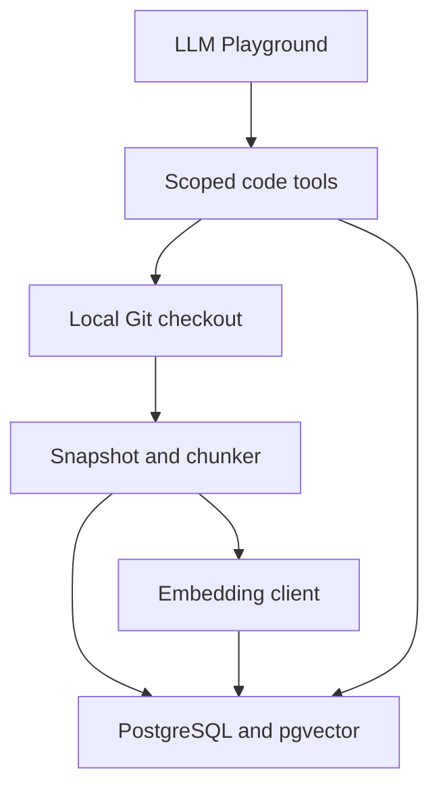

# Repository Assistant technical design

## Architecture

Run indexing as a CLI first. The Repository Assistant service exposes the same scoped read and search logic to LLM Playground. Reuse the existing embedding client and tool dispatch. Keep transport behind the tool boundary. An internal HTTP adapter is enough for a separate service. MCP can use the same contracts later.

## Ingestion and chunking

1. Resolve an authorized local checkout and revision to a full commit ID. Use a configured repository ID and optional trusted GitHub origin for citations. Never accept a local path from the model.
2. Enumerate the commit tree using NUL-delimited output from `git ls-tree`. Read selected regular blobs by object ID using `git cat-file`. Apply size, type, and deny-path policy before processing. Skip symlinks and submodules. Read Git objects without running repository code or following working-tree files.
3. Parse eligible Go blobs with `go/parser`. Use AST declarations for functions, methods, and types. Store receiver and package metadata. Derive one-based physical lines from byte offsets or unadjusted token positions, so a Go line directive cannot move a citation. AST end positions are exclusive. Use the final included byte to derive the inclusive end line.
4. Split oversized declarations at line boundaries. Repeat the signature in the embedding text when useful. Preserve the original bytes and line ranges for citation. Chunk selected SQL and config by statements or bounded line ranges. Log skipped parse errors as coverage gaps.
5. Embed the search text, then make the generation visible only after all expected chunks and vectors have been stored. Treat a failed provider batch as an incomplete generation.

## Data model and concurrency

| Record | Suggested key and fields |
|---|---|
| Repository | `repository_id`, trusted origin, local checkout locator |
| Index generation | Repo ID, commit ID, chunker version, embedding profile, status, expected and written counts |
| Source file | Generation ID and path, blob ID, language, size, line count, indexing outcome |
| Symbol | Generation ID, path, declaration range, package, receiver, name |
| Code chunk | Generation ID, path, ordinal, source range, exact source, search text, embedding |

Define a unique generation key over repository, commit, chunker version, and embedding profile. Allow one active writer per key using an expiring lease with an ownership token. Reject writes and publication from an expired owner. Uniquely key chunks by generation, path, and ordinal so retries can upsert safely. Search only ready generations and keep the generation pinned for the whole run. Use one fixed vector dimension for the first embedding profile and validate provider output. A future profile with different dimensions needs a separate compatible storage layout.

## Retrieval

Run exact symbol and literal matching alongside pgvector cosine search. Always scope queries to the selected ready generation. Rank exact qualified symbols first for exact lookups. For open-ended questions, merge ranked candidate lists using reciprocal rank fusion. Deduplicate source ranges and cap the number of overlapping chunks from one file. Keep per-branch ranks in the trace so a missed match is diagnosable. Start with exact vector search for the small corpus and measure before adding an approximate index.

## Proposed tool contracts

The authenticated Playground binds repository, commit, and generation to a review or answer session. Scope travels out of band to the service. The model sees only the arguments in the table.

| Tool | Model arguments | Returns |
|---|---|---|
| `search_code` | Query, optional path prefix, optional result limit | Ranked ranges, excerpts, matched symbol where available, and evidence IDs |
| `read_file` | Path, start line, end line | Exact numbered source within a bounded range and an evidence ID |
| `find_symbol` | Name, optional package or receiver | Bounded candidate declarations and ranges. Ambiguity is explicit. |

Define typed outcomes for missing file, denied scope, invalid range, unready index, ambiguous symbol, and exhausted budget. Return truncation metadata on capped results. Suggested initial caps are eight tool calls, 120 lines per source read, and a 60-second answer deadline. Tune against real traces.

## Answers and citations

Represent each code claim with text and a list of evidence IDs. Register an evidence ID only for source actually delivered to the model in the current run. Validate IDs in Go and render links using a trusted GitHub origin, full commit ID, escaped path segments, and a verified line range. Render local path and commit references for fixtures without a GitHub origin. Preserve the distinction between an existing source range and a range that actually supports the claim. Evaluate the latter separately.

## Primary references

- [Git tree enumeration](https://git-scm.com/docs/git-ls-tree) · [Git object reads](https://git-scm.com/docs/git-cat-file)
- [Go parser](https://pkg.go.dev/go/parser) · [Go token positions](https://pkg.go.dev/go/token)
- [pgvector retrieval](https://github.com/pgvector/pgvector)
