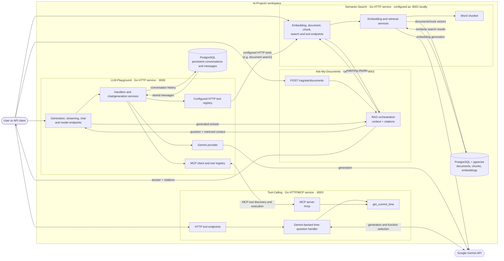
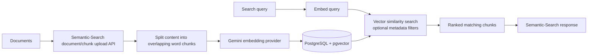
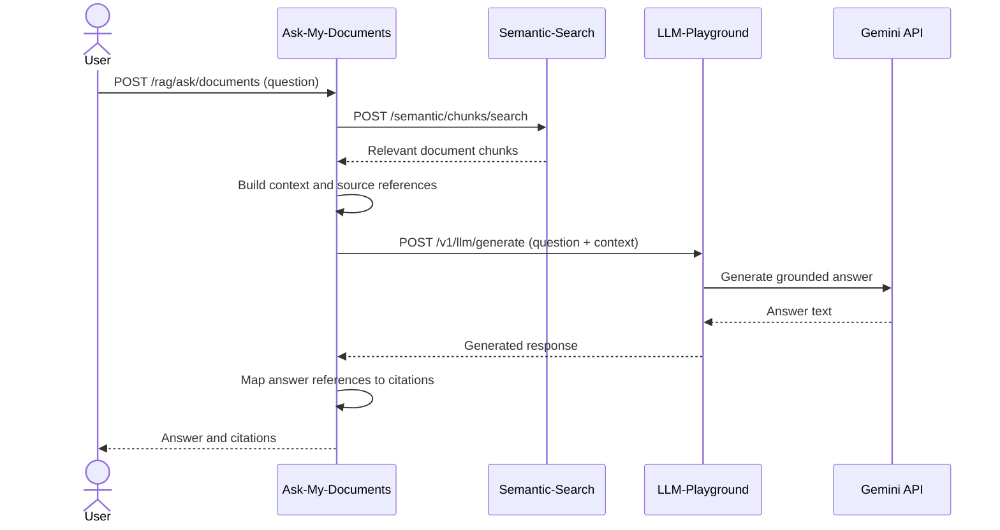

# Repository Architecture

This repository is a collection of four independently runnable Go services. The diagram shows the current local integration wiring; service URLs and external credentials are configuration-dependent.

## System overview

The configured local integration path is LLM-Playground → Semantic-Search over HTTP and LLM-Playground → Tool-Calling over MCP. Ask-My-Documents independently coordinates Semantic-Search retrieval with LLM-Playground generation. The projects can also be run independently; these links are not a single shared process.

## Document indexing and retrieval

Semantic-Search owns document and chunk indexing, embeddings, persistence, and retrieval. It exposes these capabilities through its HTTP API; it does not depend on Ask-My-Documents to perform indexing.

## Document-grounded question flow

## LLM tool flow

LLM-Playground can make tools available to model requests in two ways:

1. **Configured HTTP tools** are discovered and invoked through the application’s tool registry. The local configuration includes a document-search tool backed by Semantic-Search.
2. **MCP tools** are discovered from configured MCP servers and invoked through the MCP client. The local configuration connects to Tool-Calling’s `/mcp` endpoint, which exposes `get_current_time`.

Tool-Calling also has HTTP endpoints for its time and tool operations, so it can be exercised without routing through LLM-Playground.

## Service responsibilities

| Project | Owns |
| --- | --- |
| [LLM-Playground](../LLM-Playground/) | Generation, streaming, chat, Gemini provider integration, conversation persistence, and tool orchestration |
| [Semantic-Search](../Semantic-Search/) | Document ingestion, chunking, embedding, vector storage, similarity search, and search tools |
| [Ask-My-Documents](../Ask-My-Documents/) | Retrieval-augmented question orchestration, context construction, answer generation requests, and citations |
| [Tool-Calling](../Tool-Calling/) | Time-tool implementation, HTTP tool endpoints, and an MCP server exposing tools |

Each project has its own Go module, configuration, and server entrypoint. PostgreSQL connections, API credentials, and service addresses are configured per project.
